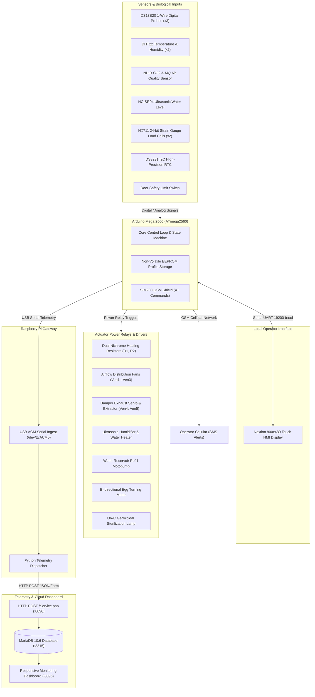

# IoT Egg Incubator Automation Platform

[](https://www.arduino.cc/)
[](https://nextion.tech/)
[](https://www.python.org/)
[](https://www.php.net/)
[](https://mariadb.org/)
[](https://www.docker.com/)
[](https://www.labcenter.com/)
[](LICENSE)

An industrial-grade, cyber-physical embedded automation platform designed for commercial poultry and waterfowl egg incubation. The system combines multi-point digital sensor fusion, precision microclimatic temperature and humidity regulation, automated bi-directional egg turning, load-cell embryo weight loss monitoring, cellular GSM SMS alerting, a Nextion 800x480 resistive touch HMI, an edge Raspberry Pi serial telemetry gateway, and a real-time web monitoring dashboard.

Originally engineered, wired, and calibrated as a full hardware prototype with custom electronic schematics designed in Proteus 8 Design Suite.

---

## Architectural Workflow



---

## Key Hardware Features & Engineering Innovations

### 1. Multi-Point Sensor Fusion & Chamber Uniformity
- **3x Dallas DS18B20 1-Wire Digital Thermometers:** Spatial thermal distribution sampling across lower, middle, and upper egg incubation trays, eliminating microclimatic hot spots.
- **2x DHT22 Digital Hygrometers:** Redundant relative humidity (RH) measurement preventing sensor drift during prolonged high-humidity periods.
- **2x HX711 24-bit ADCs with Strain Gauge Load Cells:** Measures continuous egg moisture loss. Avian embryonic respiration requires eggs to lose between 11% and 14% of fresh weight by pipping day; continuous weight logging verifies metabolic development without opening the chamber.
- **HC-SR04 Ultrasonic Sonar:** Non-contact water level tracking in the ultrasonic humidifier reservoir, activating an automated refill motopump and triggering dry-run heater protections.
- **NDIR CO2 & MQ Air Quality Probes:** Measures carbon dioxide buildup from developing embryos, automatically actuating the damper ventilation exhaust fan when CO2 levels exceed 3,000 ppm.
- **DS3231 Real-Time Clock (RTC):** Battery-backed hardware RTC retaining incubation schedules, incubation days, and egg-turning timers during power outages.

### 2. Microclimatic Actuation & Thermal Dynamics
- **Staged Heating Resistors ($R_1, R_2$):** Inverted-logic relay control activating one or both heating elements depending on thermal error margins ($Setpoint \pm 0.3^\circ C$).
- **Active Airflow Recirculation ($Ven_1, Ven_2, Ven_3$):** Horizontal air distribution fans ensuring boundary layer heat penetration across egg shells.
- **Overheat Damper Venting ($Ven_4, Ven_5, Damper$):** If temperature exceeds $Setpoint + 0.7^\circ C$, the system cuts heater power, opens the motorized air damper, and activates high-velocity exhaust fans to purge excess heat instantly.
- **Bi-directional Egg Turning Mechanism:** Driven by timed relay actuation with mechanical limit switches, gently tilting eggs 45 degrees left and right to prevent embryo membrane adhesion to the shell wall.
- **UV-C Sterilization Lamp:** Germicidal disinfection routine executed prior to egg loading, preventing bacterial contamination and omphalitis in hatchlings.

### 3. Edge Telemetry Gateway & Nextion HMI
- **Local Touch HMI:** Nextion 800x480 resistive color touchscreen communicating via UART at 19,200 baud. Features multi-species profile selection, real-time gauges, manual diagnostics, and calibration.
- **Cellular Failover (SIM900 GSM Shield):** Sends real-time SMS alerts directly to the operator's phone upon critical events (temperature out of bounds, reservoir water depletion, power restoration, or hatch day completion).
- **Raspberry Pi Serial Gateway:** A Python 3 daemon reads telemetry lines from `/dev/ttyACM0` and transmits authenticated HTTP POST payloads to the web monitoring backend.

---

## Biological Incubation Profiles

The firmware stores standard species parameters in non-volatile EEPROM:

| Species Profile | Total Days | Incubation Temp | Incubation RH | Hatching Phase (Last 3 Days) | Turning Interval |
| :--- | :---: | :---: | :---: | :---: | :---: |
| **Gallina (Chicken)** | 21 Days | 37.5 - 37.8 C | 55% - 60% | 37.2 C / 70% - 75% RH (No turning) | Every 60 - 120 mins |
| **Pato (Duck)** | 28 Days | 37.4 - 37.6 C | 60% - 65% | 37.0 C / 75% - 80% RH (Cooling cycles) | Every 60 - 120 mins |
| **Codorniz (Quail)** | 17 Days | 37.5 - 37.7 C | 50% - 55% | 37.3 C / 65% - 70% RH (No turning) | Every 60 mins |
| **Personalizado (Custom)** | Configurable | User Defined | User Defined | User Defined | User Defined |

---

## Hardware Pinout Reference (Arduino Mega 2560)

| Pin | Type | Assignment | Functional Description |
| :--- | :--- | :--- | :--- |
| `Pin 3` | Digital I/O | OneWire Bus | Master 1-Wire communication for DS18B20 temperature probes |
| `Pin 4` | Digital Output | `TRIG` | Ultrasonic sensor trigger pulse (water level) |
| `Pin 5` | Digital Input | `ECO` | Ultrasonic sensor echo pulse duration |
| `Pin 7` | Digital I/O | `DHT22_PIN` | Primary relative humidity and temperature sensor |
| `Pin 8` | Digital I/O | `DHT22_PIN1` | Secondary relative humidity sensor for chamber redundancy |
| `Pin 9` | Digital Output | `SIM900_PWR` | Hardware power sequence pulse for SIM900 GSM shield |
| `Pin 10, 11` | SoftwareSerial | `SIM900_RX/TX` | AT command interface for cellular SMS alerts |
| `Pin 14, 15` | SoftwareSerial | `CO2_RX/TX` | Serial interface for NDIR CO2 carbon dioxide sensor |
| `Pin 22 - 24` | Digital Output | `ven1 - ven3` | Horizontal chamber air recirculation fans |
| `Pin 25` | Digital Output | `ven4` | High-flow exhaust extractor fan |
| `Pin 26` | Digital Output | `ven5` | Active damper venting fan |
| `Pin 27` | Digital Output | `damper` | Motorized damper mechanical exhaust flap |
| `Pin 28, 29` | Digital Output | `r1, r2` | Staged nichrome heating elements |
| `Pin 30` | Digital Output | `mb` | Water reservoir replenishment motopump |
| `Pin 31` | Digital Output | `hum` | Ultrasonic cold mist humidifier module |
| `Pin 32` | Digital Output | `ca` | Water heater element for warm vapor generation |
| `Pin 33` | Digital Input | `sn` | Water reservoir physical high/low level probe |
| `Pin 34` | Digital Input | `fcp` | Chamber door mechanical safety limit switch |
| `Pin 35, 37` | Digital Output | `tiraled1, tiraled2` | Interior LED illumination strips |
| `Pin 39, 40` | Digital Output | `led1, led2` | Bi-directional H-bridge / relay motor control (tray tilt) |
| `Pin 42, 43` | Digital I/O | `DOUT1, SCK1` | HX711 24-bit ADC for Tray Load Cell 1 |
| `Pin 44, 45` | Digital I/O | `DOUT2, SCK2` | HX711 24-bit ADC for Tray Load Cell 2 |
| `Pin 48` | Digital Output | `lampuv` | UV-C germicidal sterilization lamp |
| `Pin 49` | Digital Output | `ven6` | Electronics enclosure heatsink cooling fan |
| `Pin 50, 52, 53` | Digital I/O | `ourWire1 - 3` | Discrete 1-Wire channels for zone DS18B20 probes |
| `Pin A0` | Analog Input | `mq` | MQ-series gas and air quality sensor |
| `SDA, SCL` | I2C Bus | `Wire` | DS3231 Real-Time Clock communication |

---

## Repository Structure

```text
iot-eggs-incubator-automation/
├── Arduino/
│   ├── incubadora/
│   │   └── incubadora.ino          # Complete ATmega2560 embedded C++ firmware (1293 lines)
│   └── libraries/                  # Standalone C++ Arduino libraries
│       ├── dallastemperature/      # DS18B20 1-Wire temperature driver
│       ├── dht/                    # DHT22 humidity sensor driver
│       ├── eepromex/               # Extended EEPROM read/write manager
│       ├── HX711-master/           # 24-bit ADC strain gauge load cell driver
│       ├── ITEADLIB_Arduino_Nextion-master/ # Nextion HMI display driver
│       ├── OneWire/                # Maxim 1-Wire bus protocol
│       └── RTClib/                 # DS3231 high-precision I2C RTC driver
├── Documentacion/
│   ├── Esquematico.pdsprj          # Proteus 8 Design Suite schematic CAD project
│   └── INCUBADORA ESQUEMATICO.PDF  # Full electronic circuit schematic diagram
├── Interfaz/
│   ├── interfaz.HMI                # Nextion Editor source project file
│   ├── interfaz.tft                # Compiled binary file for Nextion display via SD card
│   ├── MONITOREO TIEMPO REAL/      # HMI screen graphics (800x480 resolution)
│   └── *.png, *.jpg                # Graphic buttons, species icons, thermometers
├── gateway/
│   ├── serial_telemetry_gateway.py # Python 3 serial ingest and HTTP dispatcher
│   └── incubadora-gateway.service  # Systemd service for Raspberry Pi auto-start
├── Web/
│   ├── ConfigBD.php                # PDO database connection with environment variable support
│   ├── Service.php                 # Ingest endpoint receiving HTTP POST telemetry
│   ├── index.php                   # Real-time tabular monitoring dashboard
│   ├── css/ & js/                  # Responsive Bootstrap styling and scripts
│   └── vendor/                     # UI components (Select2, Perfect-Scrollbar)
├── docker/
│   └── init.sql                    # MariaDB schema and realistic avian incubation seeds
├── Dockerfile                      # PHP 8.1 Apache container for telemetry dashboard
├── docker-compose.yml              # Turnkey local orchestration (Web, DB, phpMyAdmin)
└── .env.example                    # Environment template
```

---

## Quick Start with Docker Compose

Run the complete telemetry dashboard and MariaDB database locally without physical hardware:

### 1. Clone the Repository
```bash
git clone git@github.com-personal:KevinAndrey96/iot-eggs-incubator-automation.git
cd iot-eggs-incubator-automation
```

### 2. Configure Environment
```bash
cp .env.example .env
```

### 3. Spin up the Containers
```bash
docker-compose up -d --build
```

The stack launches three interconnected services:

| Service | Port | Description |
| :--- | :--- | :--- |
| **Web Telemetry Dashboard** | [http://localhost:8096](http://localhost:8096) | Live monitoring interface displaying real-time sensor metrics |
| **phpMyAdmin** | [http://localhost:8097](http://localhost:8097) | Visual MariaDB database administration interface |
| **MariaDB 10.6** | `localhost:3315` | Relational database pre-seeded with 24h incubation data |

### 4. Run Simulated Telemetry (Mock Mode)
To simulate the physical Arduino Mega sending continuous sensor readings over serial:
```bash
python3 gateway/serial_telemetry_gateway.py --mock --interval 5 --url http://localhost:8096/Service.php
```
Open [http://localhost:8096](http://localhost:8096) to watch the live table update with real-time temperature, humidity, water level, and weight data.

---

## Running on Raspberry Pi (Edge Gateway)

1. Connect the Arduino Mega to the Raspberry Pi via USB cable.
2. Verify the serial port:
   ```bash
   ls -la /dev/ttyACM*
   ```
3. Run the gateway daemon:
   ```bash
   python3 gateway/serial_telemetry_gateway.py --port /dev/ttyACM0 --url http://your-server-ip:8096/Service.php
   ```
4. Install as a systemd service:
   ```bash
   sudo cp gateway/incubadora-gateway.service /etc/systemd/system/
   sudo systemctl daemon-reload
   sudo systemctl enable --now incubadora-gateway.service
   ```

---

## Author & Engineering Credits

- **Hardware, Firmware & Platform Architecture:** [Kevin Andrey Herrera Silva](https://github.com/KevinAndrey96)
- **Primary Contact:** [kahs_kevin@hotmail.com](mailto:kahs_kevin@hotmail.com)
- **Portfolio Showcase:** [KevinAndrey96](https://github.com/KevinAndrey96)

---

## License

This software and hardware documentation are released under the [MIT License](LICENSE).
